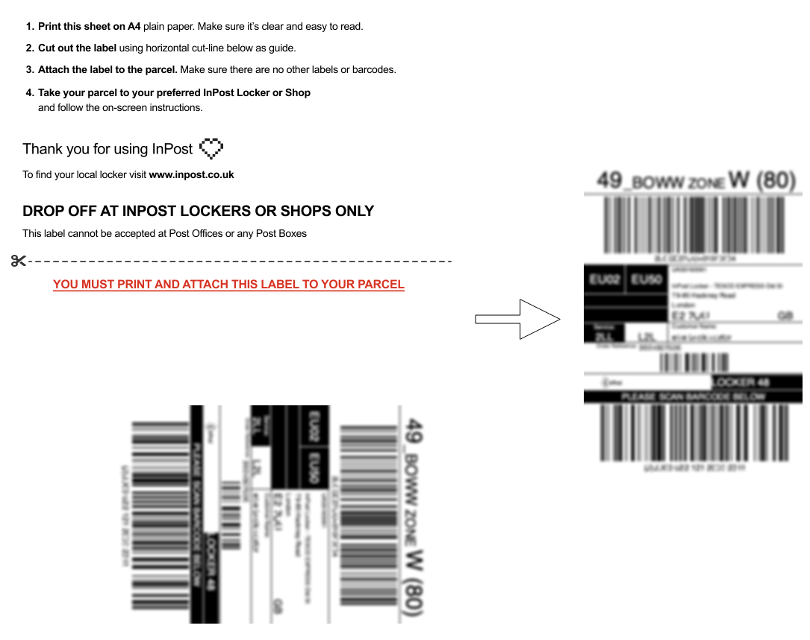

# InPost Label Fixer

A CLI and API that accepts an InPost A4 shipping label and outputs the cropped 4x6" label for use with a label printer.

> [!NOTE]
> This extracts the label using the exact position shown in the example below. If your A4 has the label in a different position this won't work. See #7




## Usage

```
# CLI
uv run src/process.py -i input.pdf -o output.pdf

# API locally
uv run uvicorn api:app --app-dir src
curl -F file=@input.pdf localhost:8000/process -o label.pdf

# API via Docker
docker run -p 8000:8000 ghcr.io/bertiewils/inpost-label-fixer:latest
```

To use as a share target on Apple devices see [docs/apple-shortcut.md](docs/apple-shortcut.md).

## Development

```
# CLI
uv run src/process.py -i input.pdf -o output.pdf

# API
uv run uvicorn api:app --app-dir src --reload
```
