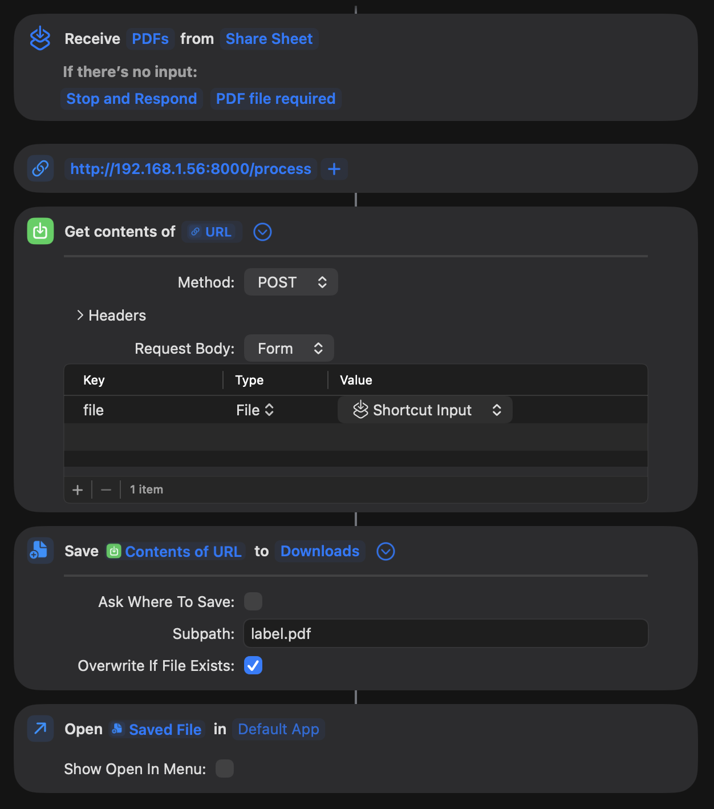
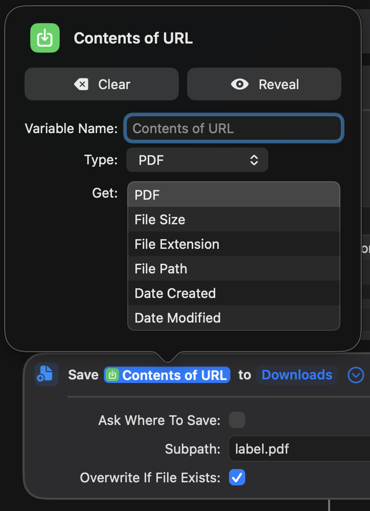

# Using with Apple Shortcuts

You can host the API on a server and call that from Shortcuts.

Workflow:

1. Open an A4 pdf label
2. Share the pdf to the 'InPost Label Fix' shortcut
3. The fixed label will open, ready to be printed

Notes:
- Make sure 'Show in Share Sheet' is enabled in the Shortcut details
- Update to your server URL/IP address in the second box, keeping the `/process` path
- It is set to overwrite the returned label.pdf file each time so you don't end up with lots of files

For an importable shortcut, see [inpost-label-fix.shortcut](inpost-label-fix.shortcut).

To set up manually:

